# Intrusion Detection System Hybrid(SIGNATURE + ML) and Honeypot

## Table of Contexts

- [What is the Project?](#what-is-the-project)
- [Tech Stack](#tech-stack)
- [Features](#features)
- [Dependencies](#dependencies)
- [Working Demo](#working-demo-to-show-project-functionality)
- [Credits](#credits)

## What is the Project?

- An Intrusion Detection System is a tool that is commonly used to monitor the traffic and send Alerts/Information on potentially suspicious
  behavior and the appropriate source.
- A Honeypot is a "trap" of sorts, which is often used in order to identify and catch malicious users while avoiding non-malicious ones.
  By creating a fake target/decoy that would not normally be accessed or interacted with. It can reveal malicious attempts cause harm to an
  organization and it's infrastructure  

Intrusion Detection Systems come in a few flavors:-
  1. Signature based
  2. Anomaly based
  3. Hybrid [Consisting of both Signature and Anomaly]

This Project is Hybrid, consisting of both a trained model and signature (by parsing the ruleset) based detection.
Furthermore, Port Honeypots are used and personally configurable with the specific port and banner for each port.

## Tech Stack

### Programming Languages
- Python
- HTML
- CSS

### Machine Learning & Data Processing
- XGBoost
- Pandas

### Networking & Comms
- Scapy
- Socket Programming

### Web Framework
- Flask

### System Monitoring
- Psutil

### Concurrency - Multithreading
- Python Threading

### Data Format
- JSON

## Features
Hybrid IDS using ML, Signature and Honeypot

This Project:-
### 1. Real-time Monitoring
- Continuously monitors network traffic in real time
- Uses multi-threading to handle multiple processes concurrently (packet sniffing, analysis, and alerting) without blocking execution

### 2. Alert Generation System
- Generates alerts for detected suspicious activity
- Classifies alerts into 3 different tags (CLEAN, DETECTED, HONEYPOT)

### 3. Port-Based Honeypots
- Simulates fake activity/purpose on configurable ports
- Captures and logs interaction attempts (would not normally be seen without an nmap scan)

### 4. Whitelist Filtering
- Allows trusted IPs/services to bypass detection rules [configurable]
- Reduces false positives and improves accuracy

### 5. Graphical User Interface (Dashboard)
- Web-based interface for being notified of alerts in real time
- Built using Flask
- Shows Uptime, alerts, clean flows, cpu core usage, memory usage (in MB), whether or not the IDS is online of offline, top attackers and ports are which there are said attack
- Comes with Both Light and Dark Mode


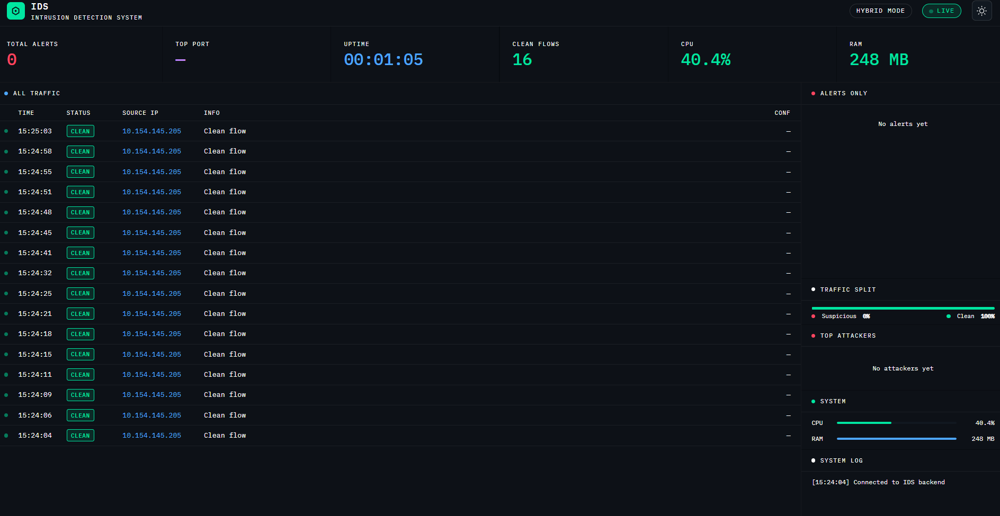

*Figure : Dark Mode*


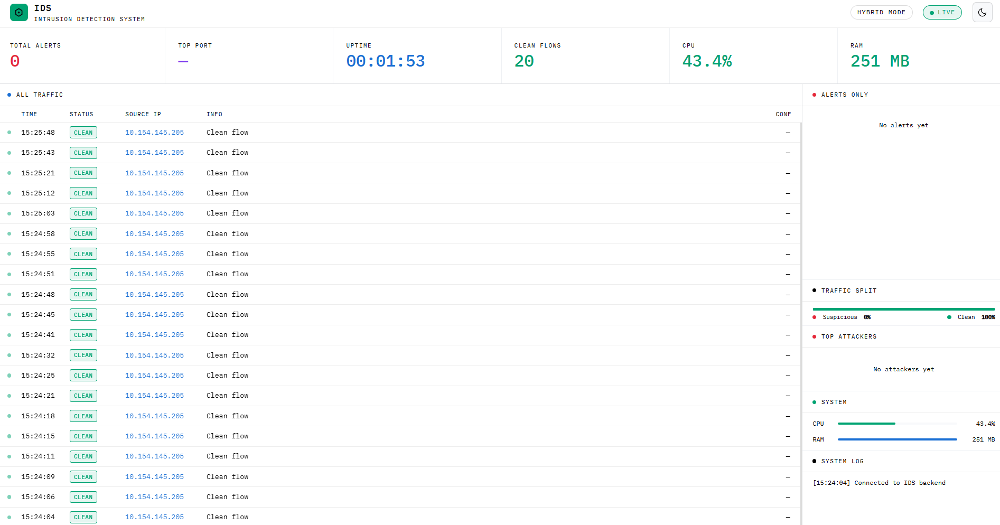

*Figure : Light Mode*

## Dependencies

### Npcap
Ensure that you have properly installed npcap and specifically checked on the "Install Npcap in WinPcap API-compatible Mode" as shown in the figure below

Link:- [Npcap](https://npcap.com/)

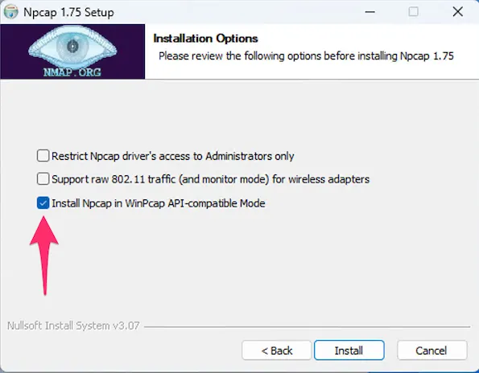

*Figure : Make sure this is checked in order for the project to work*

### Python
Recommended: Python 3.8 or higher as a safe bet

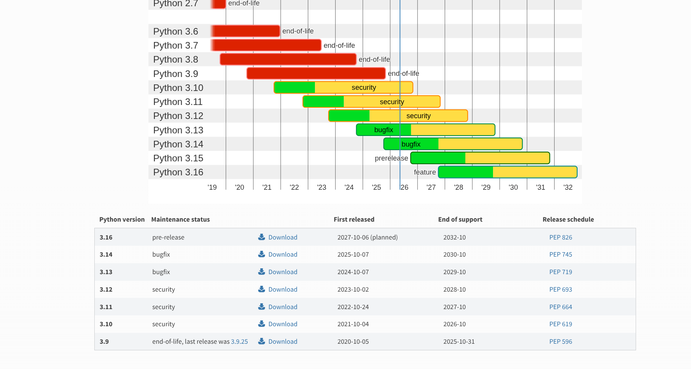

*Figure : Make sure you pick a stable recent version*

Link:- [Python](https://www.python.org/downloads/)

### Libraries and Framework

*Flask*

`pip install flask`


*Scapy*

`pip install scapy`


*Pandas*

`pip install pandas`


*NumPy*

`pip install numpy`


*XGBoost*

`pip install xgboost`


*Scikit-learn*

`pip install scikit-learn`


*Psutil*

`pip install psutil`


*Command to Download all*

`pip install flask scapy pandas numpy xgboost scikit-learn psutil`

### Operating Systems

*Supported and Tested on Windows 10/11*


*Should work on Linux [Depending on Privelege]*


### Dashboard on working browsers:
- Chrome
- Firefox
- Microsoft Edge

## Working Demo [to show project functionality]

### Pre-requisites for Testing

- *Virtual Machine settings*
In the network interface(of Virtual box in this case), set it to Host-only Adapter and Promiscious Mode Allow All  

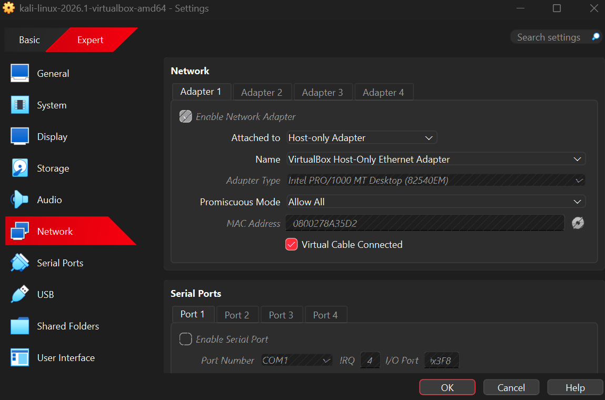


- *Ipv4 address of the Attacking system is as below:*

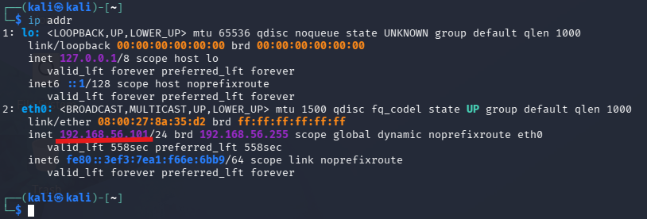


- *Ipv4 address of the Victim System*

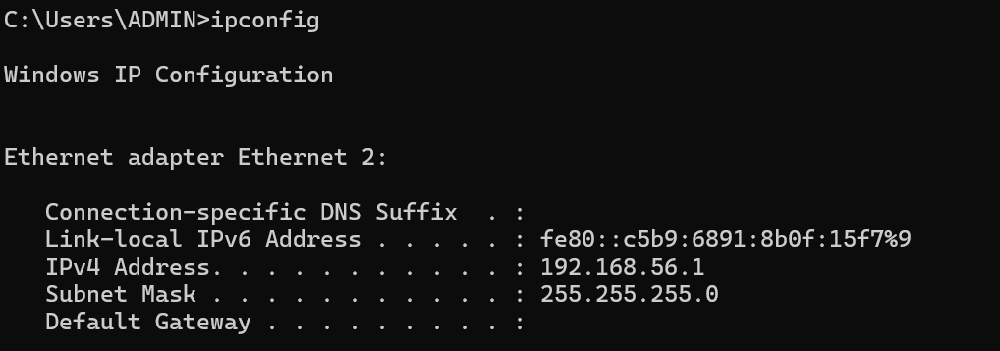


### Simulated Denial of Service

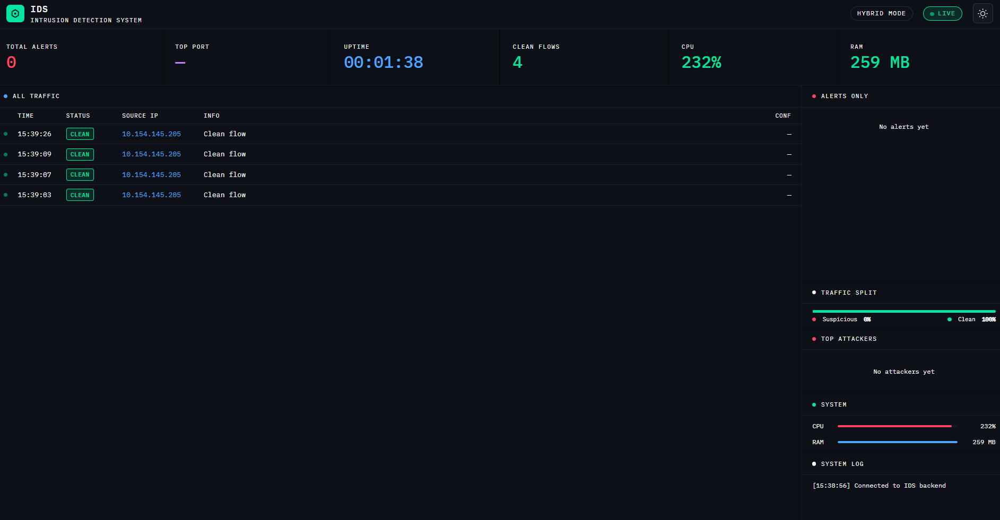

*Figure : This is an image before the attack*


using something like hping3, we can show the functinality of the project


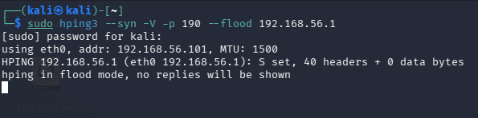

*Figure : This is the hping3 command performed*


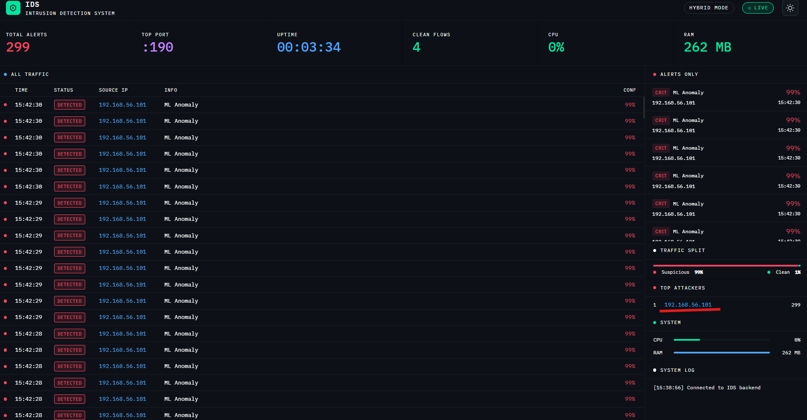

*Figure : This is an image during the attack*


### Port Honeypots

First we shall configures the ports where the fake/honey services shall be present on which port
In the honeypot.py file, we can clearly see it and can be configured

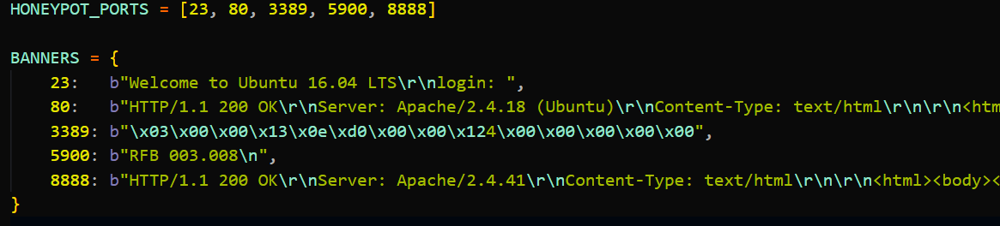

*Figure : In this case, I have personally set up some*


Now the attacker will do an nmap service scan of services.
This is an example of what they may see

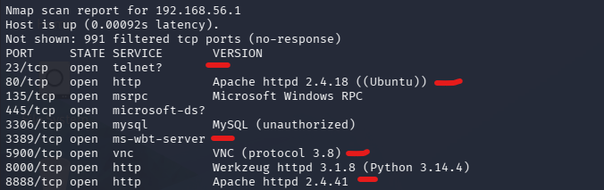
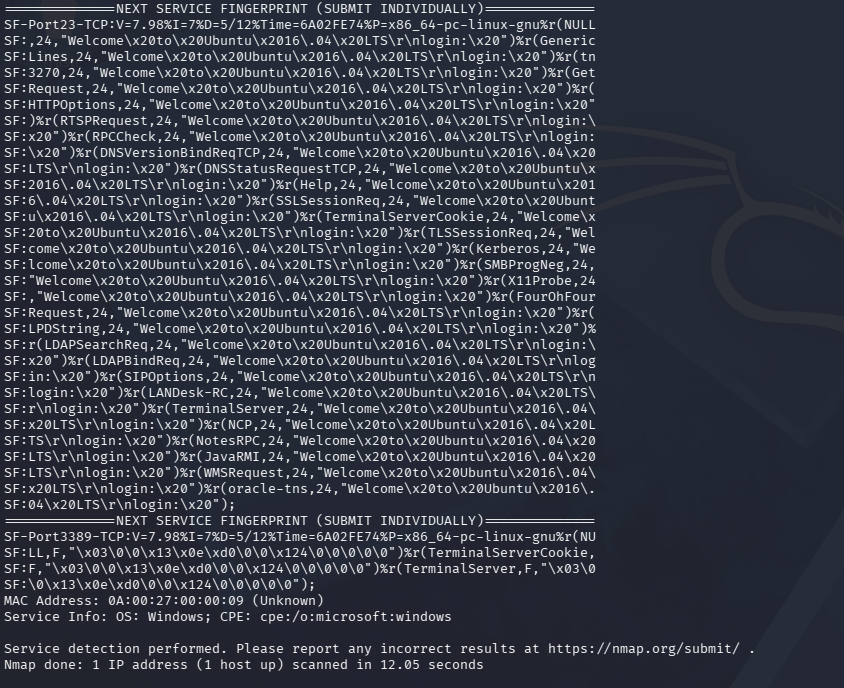

*Figure : I have put the red line on the ports that were our set up honeypots*


Now the attacker may attempt to connect to the port that they percieve as easy pickings 

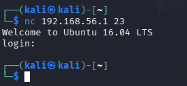

*Figure : In this case port 23 (The login in the port is deception and not real, can be configured to log attacker's inputs into it) *


While the attacker is interacting with ports that would not normally be visible to a non-malicious user, An alert is sent showing the port and ipv4 address of the attacker.


## Credits

**NF-UNSW-NB15-v3 and NF-ToN-IoT-v3 datasets:-**

```
@misc{luay2025NetFlowDatasetsV3,
title = {Temporal Analysis of NetFlow Datasets for Network Intrusion Detection Systems},
author = {Majed Luay and Siamak Layeghy and Seyedehfaezeh Hosseininoorbin and Mohanad Sarhan and Nour Moustafa and Marius Portmann},
year = {2025},
eprint = {2503.04404},
archivePrefix= {arXiv},\
primaryClass = {cs.LG},
url = {https://arxiv.org/abs/2503.04404}
}
```

**CIC-DDoS2019:-**
```
Dr. Iman Sharafaldin, Dr. Saqib Hakak, Dr. Arash Habibi Lashkari Dr. Ali Ghorbani.

I. Sharafaldin, A. H. Lashkari, S. Hakak and A. A. Ghorbani, "Developing Realistic Distributed Denial of Service (DDoS) Attack Dataset and Taxonomy," 2019 International Carnahan Conference on Security Technology (ICCST), Chennai, India, 2019, pp. 1-8, doi: 10.1109/CCST.2019.8888419. keywords: {Computer crime;Taxonomy;IP networks;Protocols;Cloud computing;Feature extraction;Tools;DDoS;IDS;DDoS Dataset;DDoS taxonomy;Network Traffic},


https://ieeexplore.ieee.org/abstract/document/8888419
```

**Snort Community Ruleset:-**  
```
Licensed under the GNU General Public License (GPL)
These rules are developed and maintained by the Snort open-source community and contributors. All intellectual property rights remain with the original authors.
```
